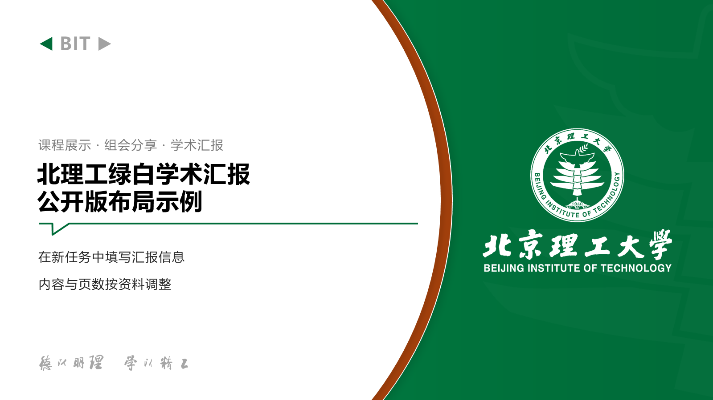

# 北理工绿白学术 PPT Skill

让 AI 按北京理工大学绿白学术风格制作可编辑 PPT，适用于课程展示、组会论文分享、开题与答辩。



## 下载

- [下载完整技能 ZIP](https://github.com/ycx-max/bit-academic-slides/archive/refs/heads/main.zip)
- [下载空白 PPT 模板](https://github.com/ycx-max/bit-academic-slides/raw/refs/heads/main/assets/layout-scaffold.pptx)
- [下载 8 页公开版参考 PPT](https://github.com/ycx-max/bit-academic-slides/raw/refs/heads/main/assets/reference.pptx)

也可使用 GitHub 页面的 **Code → Download ZIP**。不使用 AI 技能，也能直接下载 PPTX 编辑。

## 安装到本地技能目录

将 ZIP 解压后的仓库目录重命名为 `artifact-template-bit-academic-slides`，放入你的技能目录，例如 `~/.codex/skills/`；确保最终路径为 `~/.codex/skills/artifact-template-bit-academic-slides/SKILL.md`，不要多嵌套一层 ZIP 目录。然后重新打开相应会话以加载技能。

也可以克隆到目标目录：

```bash
git clone https://github.com/ycx-max/bit-academic-slides.git ~/.codex/skills/artifact-template-bit-academic-slides
```

使用自定义技能根目录时，将目标路径换成你的实际目录。其他支持 `SKILL.md` 的 AI 工具可将本目录放入其对应技能目录，并按该工具的安装方式使用。

## 使用示例

```text
使用 $artifact-template-bit-academic-slides，
把这篇论文制作成 15–20 分钟中文组会 PPT。
保留论文架构图和关键实验图表，附逐页演讲备注。
```

```text
调用北理工 PPT 技能，把这个网页整理成学术汇报 PPT，
保留网页图片；图太长时分区放大，并标注资料来源。
```

提供论文 PDF、网页、笔记、数据或已有演示稿即可。页数、时长和内容随任务调整，不固定为参考稿的 8 页。生成完整 PPT 需要运行技能的 AI 工具；仓库脚本只负责准备空白结构。

## 不用 AI：生成指定页数的空白 PPT

需要 Python 3.10+。建议在虚拟环境内安装依赖：

```bash
python -m pip install -r requirements.txt
python scripts/make_scaffold.py draft.pptx --slides 12
```

输出保留原生母版、封面与正文样式，可在 PowerPoint、WPS 或兼容工具中填充。脚本拒绝覆盖已有文件。字体默认使用微软雅黑；仓库不附字体，其他系统可能发生字体替换。

## 包含的内容

| 路径 | 用途 |
|---|---|
| `SKILL.md` | AI 技能入口与生成要求 |
| `assets/layout-scaffold.pptx` | 2 页空白结构，含原生母版 |
| `assets/reference.pptx` | 8 页通用教学示例，无真实个人信息和实验数据 |
| `assets/slide-01.png` … `slide-08.png` | 参考稿逐页预览 |
| `references/design-system.md` | 配色、字体、几何、图表与讲稿规范 |
| `references/layout-recipes.md` | 构图建议和占位符使用方式 |
| `scripts/make_scaffold.py` | 生成指定页数的空白 PPTX |

模板正文、原生图形和新增表格可以编辑；图片内的文字仍属于图片。数据图应从你提供的真实数据生成，保留数据工作簿。生成后仍应检查科学内容、署名、图片清晰度与演讲时间。

## 公开版本与授权

此仓库由原本地模板技能整理：保留绿白视觉系统，课程署名、学号、教师信息、实验照片与结果已替换为通用示例。未包含原始个人课程稿、研究资料库或生成的论文分享 PPT。

脚本与原创技能说明使用 [MIT License](LICENSE)。学校名称、校徽字标及其他第三方标识不纳入 MIT 授权，见 [NOTICE](NOTICE.md)。本项目为个人分享，不是北京理工大学官方发布，也不表示学校认可或背书。

欢迎通过 Issues 反馈版式问题，通过 Pull Requests 改进兼容性和说明。
